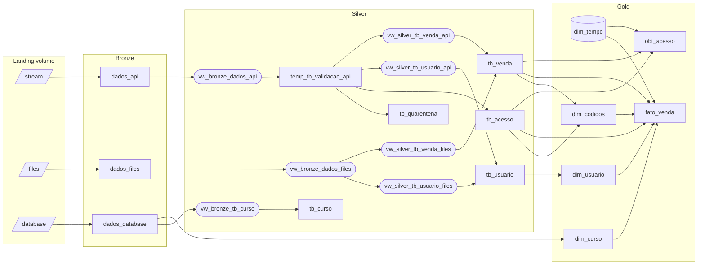
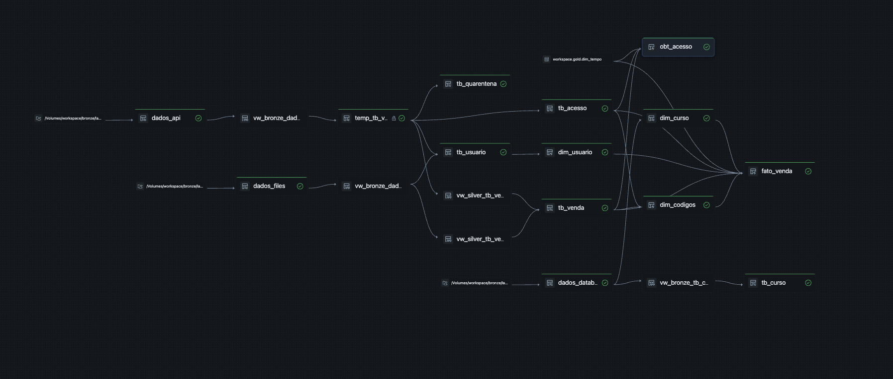

# Architecture

## The case

Data's Light Academy sells three online courses. Sales and site activity reach the
lakehouse through three channels:

| Source | Simulates | Format | Landing path | `origem` value |
|---|---|---|---|---|
| API | Site access events with optional user, product and payment payload | JSON (streamed) | `/Volumes/workspace/bronze/landing/stream/` | `API` |
| Files | Batches of corporate (B2B) sales sent by partner companies | CSV | `/Volumes/workspace/bronze/landing/files/` | `ARQUIVO` |
| Database | Course catalog as a change feed (insert / update / delete) | CSV | `/Volumes/workspace/bronze/landing/database/` | `DATABASE` |

All three are produced by the generators in
[explorations/functions.py](../explorations/functions.py); see
[data-generation.md](data-generation.md).

## Layers

**Bronze** — raw data as it arrived. Each source is loaded by Auto Loader into a
streaming table, adding only `processing_time` and `source_file_name`.

**Silver** — validated and conformed. API events go through a validation table
that flags invalid records; flagged rows go to a quarantine table and the rest
feed the access, user and sales tables. API and file sources are merged into
shared `tb_usuario` and `tb_venda` tables. The course change feed is applied as
SCD type 1.

**Gold** — analytics model. A star schema (`fato_venda` with `dim_usuario`,
`dim_curso`, `dim_codigos`, `dim_tempo`) and a denormalized `obt_acesso` for
access and conversion analysis. `dim_curso` keeps history as SCD type 2.

## Dataset graph

Rounded nodes are temporary views, which exist only inside the pipeline.
`dim_tempo` is a regular Delta table created outside the pipeline. Note that
`dim_curso` reads the bronze change feed directly, not `silver.tb_curso`.

The graph as rendered by the pipeline UI:

## Lakeflow features demonstrated

| Feature | Where |
|---|---|
| Auto Loader ingestion (`cloud_files`) with schema inference | [01_bronze/](../code_tips/01_bronze/) |
| File metadata column (`_metadata.file_path`) | [01_bronze/](../code_tips/01_bronze/) |
| Temporary streaming views (boundary view excluding `source_file_name`, `_rescued_data`) | [01_vw_bronze_dados_api.sql](../src/pipeline/02_silver/01_vw_bronze_dados_api.sql) and the other `vw_` files |
| Temporary (pipeline-private) streaming table | [03_temp_tb_validacao_api.sql](../src/pipeline/02_silver/03_temp_tb_validacao_api.sql) |
| Expectations that only record violations | [03_temp_tb_validacao_api.sql](../src/pipeline/02_silver/03_temp_tb_validacao_api.sql) |
| Quarantine pattern (flag column + split) | [03_temp_tb_validacao_api.sql](../src/pipeline/02_silver/03_temp_tb_validacao_api.sql), [04_tb_quarentena.sql](../src/pipeline/02_silver/04_tb_quarentena.sql) |
| Partitioning by a Boolean flag (`PARTITIONED BY`; `CLUSTER BY` rejects `BOOLEAN`) | [03_temp_tb_validacao_api.sql](../src/pipeline/02_silver/03_temp_tb_validacao_api.sql) |
| Expectations with `ON VIOLATION DROP ROW` (declared exclusion, not quarantined) | [05_tb_acesso.sql](../src/pipeline/02_silver/05_tb_acesso.sql), [08_tb_usuario.sql](../src/pipeline/02_silver/08_tb_usuario.sql) |
| Expectation kept as a commented `FAIL UPDATE` | [05_tb_acesso.sql](../src/pipeline/02_silver/05_tb_acesso.sql) |
| Two append flows into one table, one per source (`CREATE FLOW ... INSERT INTO ... BY NAME`) | [08_tb_usuario.sql](../src/pipeline/02_silver/08_tb_usuario.sql) |
| Multiple append flows into one table (`CREATE FLOW ... INSERT INTO ... BY NAME`) | [09_tb_venda.sql](../code_tips/02_silver/09_tb_venda.sql) |
| `AUTO CDC` as SCD type 1 | [11_tb_curso.sql](../code_tips/02_silver/11_tb_curso.sql) |
| `AUTO CDC` as SCD type 2 (`__START_AT` / `__END_AT`) | [02_dim_curso.sql](../code_tips/03_gold/02_dim_curso.sql) |
| Explicit schema with identity surrogate keys | [01_dim_usuario.sql](../code_tips/03_gold/01_dim_usuario.sql), [02_dim_curso.sql](../code_tips/03_gold/02_dim_curso.sql), [03_dim_codigos.sql](../code_tips/03_gold/03_dim_codigos.sql) |
| Materialized views | [04_fato_vendas.sql](../code_tips/03_gold/04_fato_vendas.sql), [05_obt_acesso.sql](../code_tips/03_gold/05_obt_acesso.sql) |

### Legacy and current syntax

The files mix the older Delta Live Tables keywords with the current ones. They
are equivalent:

| Used in this project | Current form |
|---|---|
| `CREATE OR REFRESH STREAMING LIVE TABLE` | `CREATE OR REFRESH STREAMING TABLE` |
| `CREATE OR REFRESH LIVE TABLE` | `CREATE OR REFRESH MATERIALIZED VIEW` |
| `CREATE TEMPORARY STREAMING LIVE VIEW` | `CREATE TEMPORARY VIEW` over a `STREAM(...)` source |
| `cloud_files(...)` | `STREAM read_files(...)` |
| `TEMPORARY STREAMING TABLE` | `PRIVATE STREAMING TABLE` |
